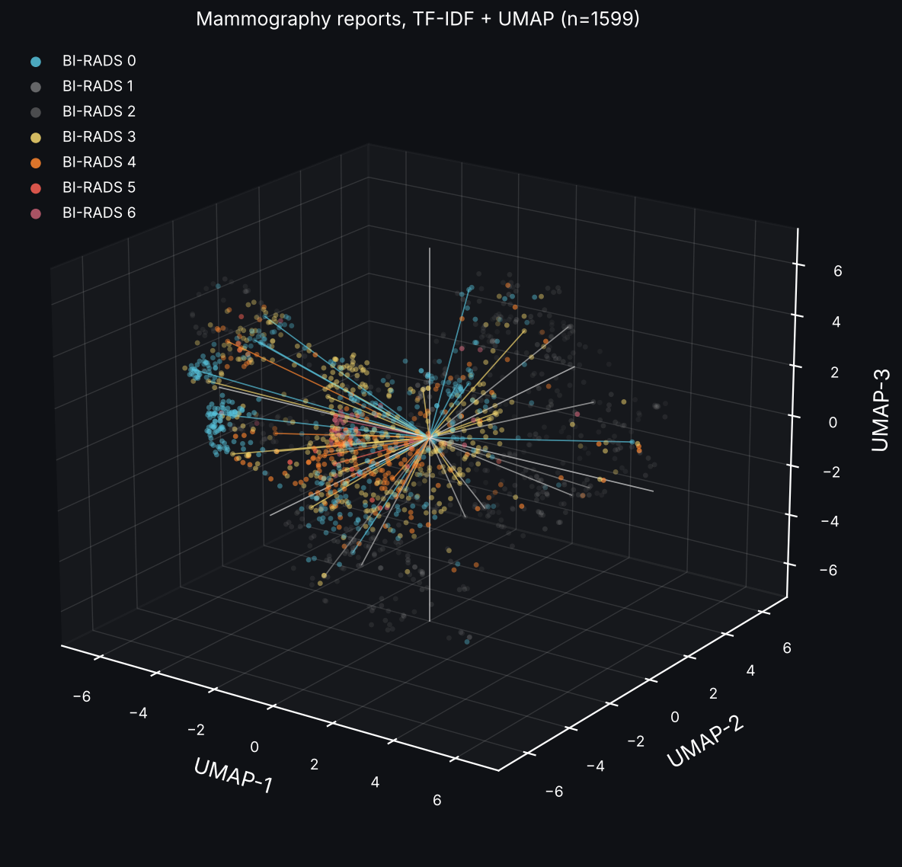
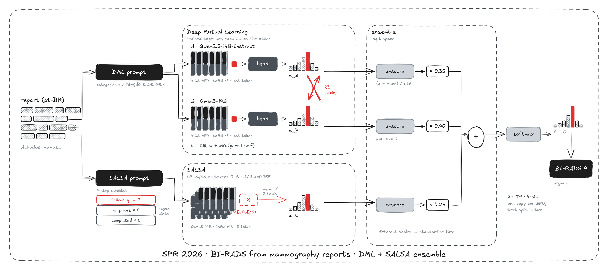
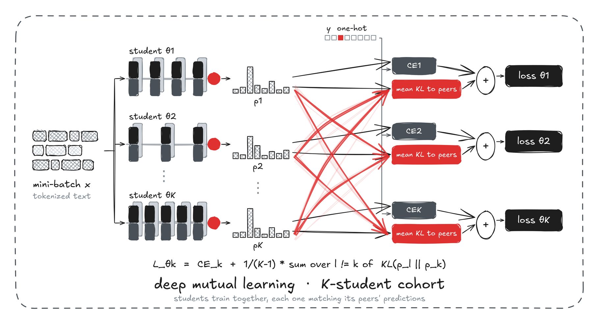
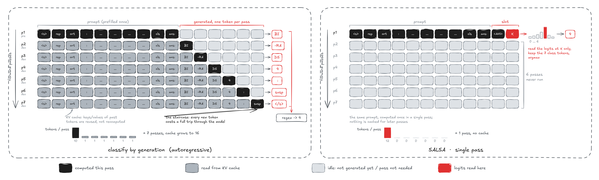

<div align="center">

# 🩺 SPR 2026 · Mammography Report Classification

**Fine-tuned 14B LLMs that read Portuguese mammography reports and predict the BI-RADS category (0–6)**

🏅 **4th place** &nbsp;·&nbsp; 💶 **€3,000 prize** &nbsp;·&nbsp; [Kaggle competition ↗](https://www.kaggle.com/competitions/spr-2026-mammography-report-classification)


<br>


<br><em>the training reports embedded in 3D (TF-IDF + UMAP), coloured by BI-RADS</em>

</div>

---

## TL;DR

> Three LoRA-fine-tuned 14B models, trained in two different ways, vote in logit space:
>
> - **A + B**: Qwen2.5-14B-Instruct and Qwen3-14B trained **together** with **Deep Mutual Learning**: each learns from the labels *and* from the other's predictions, through a linear head on the last hidden state.
> - **C**: Qwen3-14B trained with **SALSA**: the class is read directly from the LM's next-token logits on the digits `0`–`6`, in one forward pass, with a noise-robust **GCE / Tsallis** loss, 3 folds.
>
> Each model's 7 logits are **z-scored per report**, blended **0.35 · 0.40 · 0.25**, and the argmax is the BI-RADS category. Everything runs in **4-bit on two 16 GB T4s**.

## Contents

1. [The task](#1--the-task)
2. [Solution at a glance](#2--solution-at-a-glance)
3. [Data](#3--data)
4. [Model A + B · Deep Mutual Learning](#4--model-a--b--deep-mutual-learning)
5. [Model C · SALSA](#5--model-c--salsa)
6. [Ensemble](#6--ensemble)
7. [Fitting three 14B models on 2× T4](#7--fitting-three-14b-models-on-2-t4)
8. [Hyper-parameters](#8--hyper-parameters)
9. [Repository & how to run](#9--repository--how-to-run)
10. [Design notes & lessons](#10--design-notes--lessons)
11. [References](#11--references)

---

## 1 · The task

Each sample is a free-text **mammography report in Brazilian Portuguese** (clinical indication + findings). The goal is to predict the report's **BI-RADS** assessment category:

| BI-RADS | meaning | what usually gives it away in the text |
|:---:|---|---|
| **0** | incomplete, needs additional imaging | a request for views or ultrasound **not yet done** |
| **1** | negative | no findings at all |
| **2** | benign finding | stable, typically benign findings, **no follow-up** |
| **3** | probably benign | benign-looking finding **with short-interval follow-up** (≈ 6 months) |
| **4** | suspicious | biopsy *should be considered* |
| **5** | highly suspicious of malignancy | biopsy *required* |
| **6** | known, biopsy-proven malignancy | prior confirmed cancer |

The hard parts are **class imbalance** (most reports are 1–2, while 5 and 6 are rare) and a few **near-identical neighbours**: 2 vs 3 (follow-up or not), 3 vs 0 (assessed vs incomplete), 4 vs 5 (suspicious vs highly suspicious).

## 2 · Solution at a glance

<p align="center"></p>

| | backbone | training method | output read from | trained on |
|---|---|---|---|---|
| **A** | Qwen2.5-14B-Instruct | Deep Mutual Learning (peer = B) | linear head on the last token's hidden state | 1× H100 80 GB, 4-bit |
| **B** | Qwen3-14B | Deep Mutual Learning (peer = A) | linear head on the last token's hidden state | 1× H100 80 GB, 4-bit |
| **C** | Qwen3-14B | SALSA + GCE loss, 3 folds | LM logits on tokens `0`–`6` at the answer slot | bf16 |

The two families are deliberately **different**: a discriminative head versus the LM's own vocabulary, a short prompt versus a checklist prompt, cross-entropy versus GCE. Their errors are less correlated, which is what makes the ensemble pay off.

## 3 · Data

- **Competition training set**, cleaned.
- **External reports, rare classes only.** From an external labelled set, only **BI-RADS 4, 5 and 6** are added. This boosts the minority classes without shifting the distribution of the common ones.
- **Splits:** a stratified **85 / 15** train/validation split for DML, and **3-fold stratified CV** for SALSA. Seed `252` everywhere.
- **Imbalance handling, two levers used together:**
  - **oversampling** of the rarest classes: DML ×2 for class 5 and ×3 for class 6, SALSA ×4 for class 5 and ×2 for class 6
  - **inverse-frequency class weights** in the loss, `w_c = N / n_c`, computed *after* oversampling
- **Model selection** on **macro-F1**, so every class counts equally.

> The data is not included in this repo; it belongs to the competition.

## 4 · Model A + B · Deep Mutual Learning

<p align="center"></p>

Instead of training two models independently, **both students train at the same time** and each one is also pulled towards its peer's predicted distribution ([Zhang et al., 2018](https://arxiv.org/abs/1706.00384)):

$$
\mathcal{L}_A = \mathrm{CE}_w(z_A, y) + \lambda\,\mathrm{KL}\!\left(p_B \,\|\, p_A\right)
\qquad
\mathcal{L}_B = \mathrm{CE}_w(z_B, y) + \lambda\,\mathrm{KL}\!\left(p_A \,\|\, p_B\right)
\qquad \lambda = 1
$$

- `CE_w` is class-weighted cross-entropy, and `p = softmax(z)`.
- The peer's distribution is **detached**, so it acts as a soft target and no gradient flows into the peer through the KL term.
- The KL term passes on the peer's **"dark knowledge"**: how plausible the *wrong* classes are (for example, a report that is "a 3, but almost a 2"). That is exactly the information the hard labels don't carry for the confusable pairs.

### Architecture

```
prompt ──► Qwen (4-bit NF4, LoRA r=8 on all linear layers) ──► hidden state of the LAST token ──► Linear(d → 7, no bias) ──► logits
```

- **Last-token pooling** works because of **left padding**: the last position is always the end of the prompt, *"Categoria BI-RADS (número apenas): "*, right where a causal LM has summarised the whole report.
- The head is initialised with `trunc_normal(std = 0.02)`, and its logits are computed in fp32.

### Training loop (one step)

1. Tokenise the batch twice, once with each model's tokenizer.
2. Run both forward passes in fp16 autocast.
3. Compute `CE_w + λ·KL(peer ‖ self)` for each model.
4. Run both backward passes.
5. Every 4 steps (gradient accumulation): unscale, **clip the gradient norm to 10**, step each optimizer and cosine scheduler.
6. After each epoch, compute validation macro-F1 and a confusion matrix, then save **each model's best checkpoint separately** (LoRA adapter + head). Each model has its own early stopping (patience 3).

<details>
<summary><b>DML prompt</b> (shared by A and B)</summary>

```text
<|im_start|>user
Você é um radiologista especialista em mamografia.

Tarefa: Classifique o laudo mamográfico abaixo em uma das categorias BI-RADS (0–6).
Instrução: Responda APENAS com o número da categoria. NÃO inclua explicação.

Categorias BI-RADS:
    0: Incompleto — necessita de imagens adicionais
    1: Negativo — sem achados
    ...
    6: Malignidade comprovada por biópsia

Regras: 0=imagem incompleta, 1=negativo, 2=benigno, 3=provavelmente benigno(seguimento 6m), ...
ATENÇÃO: 3≠2(sem seguimento), 3≠0(sem conclusão), 5≠4(alta vs suspeita).

Laudo:
{report}

Categoria BI-RADS (número apenas):
```

The **ATENÇÃO** line spells out the three hardest confusions directly in the prompt.

</details>

## 5 · Model C · SALSA

<p align="center"></p>

**[SALSA](https://arxiv.org/abs/2510.22691)** keeps the LLM as a language model instead of bolting a head onto it. The prompt ends at an answer marker, and the class is read from the **next-token logits restricted to the 7 digit tokens**:

```
… Laudo: {report} … <|im_start|>assistant\n<BIRADS>  ──►  logits[-1, {"0","1",…,"6"}]  ──►  softmax  ──►  argmax
```

- **One forward pass**, with no decoding loop, no sampling and no regex to parse a generated answer.
- The digits `0`–`6` are each a **single token** in the Qwen vocabulary, and the script asserts this.
- The LM's pretrained "meaning" of the digits is reused instead of learning a new head from scratch.

### Training: supervise one token only

At training time the full answer `<BIRADS>{y}</BIRADS><|im_end|>` is appended, and **only the digit position is labelled**. Every other position is `-100`. The loss applies the usual causal shift, slices the logits at that position to the 7 answer tokens, and remaps the token IDs to class indices 0–6. The digit position is found by walking backwards from the last `<|im_end|>`.

### Loss: Generalised Cross-Entropy (Tsallis)

$$
\mathcal{L}_{\text{GCE}} = w_y \cdot \frac{1 - p_y^{\,q-1}}{q-1}, \qquad q = 0.955
$$

Here `p_y` is the softmax probability of the true class over the 7 digit logits, and `w_y` is its class weight. GCE sits between cross-entropy and MAE, so it **down-weights examples the model confidently disagrees with**. That makes it more tolerant of the label noise that inevitably exists in radiology reports. With `q` this close to 1 it behaves almost like CE, with only a gentle robustness effect.

### A prompt that reasons like a radiologist

The SALSA prompt is a **4-step decision checklist** that mirrors how BI-RADS is actually assigned:

| step | question | routes to |
|---|---|---|
| **1** | Is the exam **complete**? | `0` only if requested imaging is **not yet done** |
| **2** | Is there **any finding**? | none → `1` |
| **3** | Is the finding **benign or suspicious**? | benign, no follow-up → `2` · benign + follow-up → `3` · suspicious → `4` / `5` / `6` |
| **4** | Final check | `3≠2` · `3≠0` · `5≠4` |

On top of the checklist, three **regex detectors** inject report-specific hints into the prompt:

| detector | matches (examples) | hint added |
|---|---|---|
| follow-up language | *controle, seguimento, retorno, reavaliação, biópsia, "6 meses"* | ⚠️ strong indicator of **3**, otherwise prefer **2** if benign |
| no prior exams | *anteriores não disponíveis, primeira mamografia* | ⚠️ missing priors does **not** imply **0** |
| already completed | *à ultrassonografia, compressão localizada, magnificação* | ⚠️ exam is **complete**, don't use **0** |

These target the 2↔3 and 0↔3 confusions with cheap, explicit signals that a model can otherwise miss in long reports.

<details>
<summary><b>SALSA prompt</b> (abridged)</summary>

```text
Você é um radiologista especialista em mamografia.

Tarefa: Classifique o laudo mamográfico abaixo em BI-RADS (0–6).
Siga os 4 passos abaixo EM ORDEM.

PASSO 1 — O exame está COMPLETO?
  → Use 0 SOMENTE se o laudo solicita imagens que AINDA NÃO foram feitas.
  {hint: ausência de exames anteriores NÃO implica categoria 0}
  {hint: complementação já realizada → exame COMPLETO, não use 0}
PASSO 2 — HÁ ALGUM ACHADO?  → se não há achados → use 1
PASSO 3 — O ACHADO É BENIGNO OU SUSPEITO?
    • 2 (SEM seguimento) …   {hint: linguagem de seguimento detectada → categoria 3}
    • 3 (COM seguimento 6m) …
    • 4 = biópsia a considerar | 5 = biópsia obrigatória | 6 = malignidade confirmada
PASSO 4 — VERIFICAÇÃO: 3≠2 | 3≠0 | 5≠4

Laudo:
{report}

Responda APENAS com o número BI-RADS no formato: <BIRADS>#Número</BIRADS>
```

At inference the chat template ends with the assistant turn `<BIRADS>`, and the trailing `<|im_end|>` is stripped, so position −1 predicts the digit.

</details>

### Training setup

- LoRA `r=16, α=32, dropout 0.05` on `q, k, v, o, gate, up, down` projections
- bf16 weights, SDPA attention, `torch.compile`
- effective batch **16** (4 × 4 accumulation), lr 2e-4, cosine schedule with 100 warm-up steps, gradient clipping 1.0
- up to 6 epochs per fold, early stopping on validation macro-F1 (patience 2)
- **3 folds**, whose adapters are all used at inference, with their logits averaged

## 6 · Ensemble

The three models output 7 numbers each, but on **very different scales**: A and B come from freshly trained linear heads, while C comes from LM vocabulary logits. Averaging raw logits would let whichever model has the largest range dominate. So each model's logits are first **standardised per report**:

$$
\tilde z = \frac{z - \operatorname{mean}(z)}{\operatorname{std}(z)}
\qquad\Longrightarrow\qquad
\hat y = \arg\max\ \operatorname{softmax}\!\left(0.35\,\tilde z_A + 0.40\,\tilde z_B + 0.25\,\tilde z_C\right)
$$

The weights favour **B** (the stronger DML student), then **A**. C gets the smallest weight but brings the most *different* signal.
The notebook also prints each model's predicted class distribution and the **3-model agreement rate**, a quick sanity check before submitting.

## 7 · Fitting three 14B models on 2× T4

Inference had to run on the Kaggle runtime: **two 16 GB T4s, no internet**. The tricks:

| problem | solution |
|---|---|
| a 14B model is about 28 GB in fp16 | **4-bit NF4 + double quantisation** (bitsandbytes), fp16 compute, roughly 8–9 GB per copy |
| two GPUs, one model at a time | load **one copy per GPU**, split the test set in two, run both halves **in parallel threads** |
| three models in sequence | after each model: move it to CPU, `del`, `gc.collect()`, `malloc_trim`, `empty_cache`, and log the free VRAM before loading the next |
| 3 SALSA folds | load, infer and free them one after another, then average their logits |
| adapters saved with a temporary `/tmp/...` base path during training | **patch `adapter_config.json`** to point at the read-only Kaggle model path before loading |
| two loading conventions | A via `AutoPeftModelForFeatureExtraction`, B via `AutoModel` + `PeftModel.from_pretrained`, matching how each was saved |
| no internet | `bitsandbytes` and `peft` installed from offline wheel datasets |

## 8 · Hyper-parameters

| | DML (A + B) | SALSA (C) |
|---|---|---|
| backbones | Qwen2.5-14B-Instruct · Qwen3-14B | Qwen3-14B |
| precision (train) | 4-bit NF4, fp16 compute | bf16 |
| LoRA | r 8 · α 16 · dropout 0 · all linear | r 16 · α 32 · dropout 0.05 · attn + MLP |
| output | linear head, last token | LM logits on `0`–`6` |
| loss | weighted CE + 1.0 · KL(peer) | weighted GCE, q = 0.955 |
| max length | 896 | 1024 |
| batch × accumulation | 2 × 4 = 8 | 4 × 4 = 16 |
| learning rate / schedule | 2e-4, cosine, 10 % warm-up | 2e-4, cosine, 100 warm-up steps |
| weight decay | 0.01 | 0.01 |
| grad clip | 10.0 | 1.0 |
| epochs / patience | 3 / 3 | 6 / 2 |
| oversampling | class 5 ×2 · class 6 ×3 | class 5 ×4 · class 6 ×2 |
| validation | stratified 15 % hold-out | 3-fold stratified CV |
| seed | 252 | 252 |

## 9 · Repository & how to run

```
.
├── src/
│   ├── train_dml.py               DML training: Qwen2.5-14B + Qwen3-14B together on one H100
│   └── train_salsa.py             SALSA training: 3-fold CV, GCE loss
├── notebooks/
│   └── inference_ensemble.ipynb   final submission: A + B + C on 2× T4, z-score ensemble
├── assets/                        figures used in this README
├── requirements.txt
└── .gitignore                     checkpoints and data are never committed
```

```bash
pip install -r requirements.txt

# 1 · train the two DML students   → backbone_{a,b}_best/  head_{a,b}_best.pt
python src/train_dml.py

# 2 · train SALSA, 3 folds         → backbone_fold_{0,1,2}_best/
python src/train_salsa.py
```

3. Upload the checkpoints as Kaggle datasets, set the paths in **section 3** of `notebooks/inference_ensemble.ipynb`, and run it on a **2× T4** Kaggle notebook. It writes `submission.csv`.

> The scripts use Kaggle `/kaggle/input/...` paths. Change the paths at the top of each file to run elsewhere.
> Training the DML pair needs about 80 GB of GPU memory (both 14B students are in memory at once).

## 10 · Design notes & lessons

- **Diversity beats a single strong model.** Two training paradigms (head vs LM logits), two prompts and two losses make errors less correlated than three runs of the same recipe would.
- **DML is a cheap ensemble booster.** Training the pair together costs one extra forward pass per step, and each student comes out better calibrated on the confusable classes than when trained alone.
- **Put domain knowledge where the model can see it.** The checklist prompt and regex hints encode the exact rules radiologists use to separate 2/3/0, at zero training cost.
- **Normalise before you blend.** Logits from different heads aren't comparable, and per-sample z-scoring was essential to make the weighted average meaningful.
- **Read logits, don't generate.** Classifying with SALSA is faster, deterministic, and can't produce an unparseable answer.

## 11 · References

- Y. Zhang, T. Xiang, T. Hospedales, H. Lu, *Deep Mutual Learning*, CVPR 2018: [arXiv:1706.00384](https://arxiv.org/abs/1706.00384)
- R. Berdichevsky, S. Nahum-Gefen, E. Ben Zaken, *SALSA: Single-pass Autoregressive LLM Structured Classification*: [arXiv:2510.22691](https://arxiv.org/abs/2510.22691)
- Z. Zhang, M. Sabuncu, *Generalized Cross Entropy Loss for Training Deep Neural Networks with Noisy Labels*, NeurIPS 2018: [arXiv:1805.07836](https://arxiv.org/abs/1805.07836)
- Qwen team, Qwen2.5 and Qwen3 model families
- ACR, *BI-RADS® Atlas*, 5th edition
